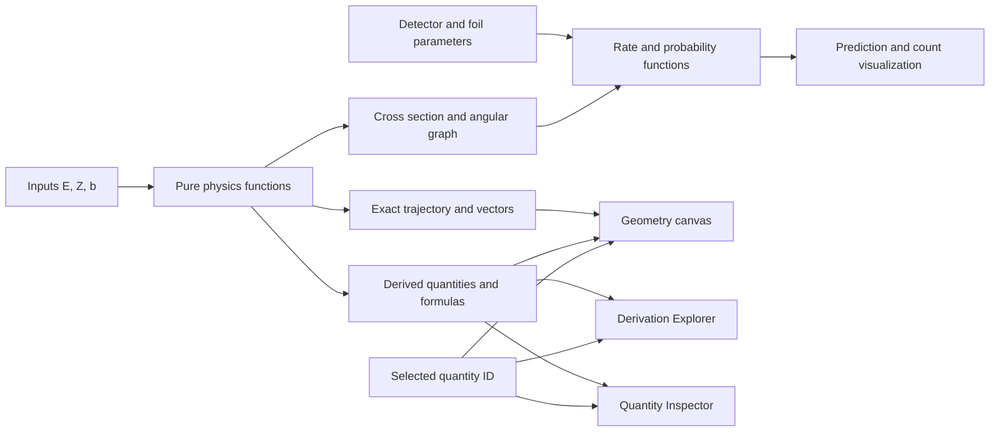

# AtomScope — Rutherford Scattering Module
## Development Specification · v0.1 (Review Draft)

> **Document type:** Feature / Physics / Interaction Development Specification  
> **Module:** `rutherford-scattering`  
> **Status:** Proposal for discussion; not an approved implementation plan  
> **Target:** Web application built with npm  
> **Source alignment:** *AtomScope — Physics Knowledge Architecture*, Part I, §3.1–3.6, §8–9  
> **Principle:** **The mathematics is the main learning interface.** Text supplements equations and visualizations; it does not replace them.

---

## 0. Executive Summary

The goal is **not** to reproduce the familiar gold-foil animation. The module should make a continuous, inspectable relationship visible:

\[
\text{incident geometry }(b,E,Z)
\longrightarrow \theta
\longrightarrow \frac{d\sigma}{d\Omega}
\longrightarrow \sigma(\Delta\Omega)
\longrightarrow P
\longrightarrow N_{\mathrm{det}}.
\]

The learning interface is built around three connected experiences:

1. **Scattering Geometry:** an exact single-particle Rutherford trajectory, quantitative labels, and an interactive *Physical Quantity Inspector*.
2. **Derivation Explorer:** parallel routes to the same scattering-angle formula: (A) vector impulse integration, (B) radial integral / effective potential, (C) analytical mechanics as an advanced path.
3. **Cross Section & Measurement:** transform an impact-parameter annulus into a scattering angular interval; compare theoretical angular distributions with predicted and simulated detector counts.

**Critical design rule:** every plotted quantity is computed from the same physics core. No decorative trajectory or arrow should contradict its equation.

---

## 1. Intended Learners and Learning Outcomes

**Audience:** students with introductory calculus, vectors, Newtonian mechanics, energy and angular momentum conservation; analytical mechanics is **not** a prerequisite for the core path.

A learner should be able to:

- Identify the measured/controlled quantities in a Rutherford-style scattering experiment: projectile energy, target charge, impact parameter, scattering angle, detector angular range, particle counts.
- Relate the exact repulsive Coulomb trajectory to \(b\), \(E\), \(Z\), \(r_{\min}\) and \(\theta\), and inspect how changing one input affects the others.
- Explain the mathematical steps of at least one derivation of the scattering-angle relationship; compare the transformations in two independent routes.
- Distinguish **impact-parameter area**, **cross section**, **differential cross section**, **solid angle**, **probability**, and **particle count** by both units and on-screen geometry.
- Derive or reconstruct the transformation \(d\sigma/d\Omega=(b/\sin\theta)|db/d\theta|\), and use the Rutherford formula to predict counts in a finite angular interval.
- State the assumptions and numerical limits of the ideal classical model.

**Out of scope for v0.1:** full atomic electron dynamics, Bohr orbits, quantum scattering, detailed nuclear form factors, multiple Coulomb scattering in thick foils, experimental apparatus reconstruction in 3D.

---

## 2. Main Learner Experience (Proposed Screen)

### 2.1 Desktop wireframe

```text
┌───────────────────────────────────────────────────────────────────────────────────┐
│ ATOMSCOPE  /  Rutherford Scattering                               [Assumptions] │
├───────────────────────────────────────────────────────────────────────────────────┤
│ [1 Geometry]    [2 Derivation]    [3 Cross Section & Measurement]                │
├───────────────────────────────────────────────┬───────────────────────────────────┤
│                                               │  PHYSICAL QUANTITIES             │
│  PHYSICS CANVAS / INTERACTIVE GRAPH            │                                   │
│                                               │  Incident energy       E  [5 MeV]│
│   incoming →    • α                          │  Target charge        Z  [79]   │
│                ······· ↗ outgoing              │  Impact parameter     b  [  ] fm│
│                      ↗ θ                      │  Scattering angle    θ  [  ] ° │
│                  ⊕ nucleus                    │  Closest approach  r_min [ ] fm │
│                                               │                                   │
│  [show b] [show θ] [show F] [show v] [show r]  │  click a symbol → highlight      │
│                                               │                                   │
├───────────────────────────────────────────────┴───────────────────────────────────┤
│  FORMULA PANEL:   tan(θ/2) = κ/(2 E b)   |   κ = z Z e²/(4π ε₀)                 │
│  [Click θ] [Click b] [Open derivation] [Pin value]                                │
├───────────────────────────────────────────────────────────────────────────────────┤
│  Contextual chart / data / derivation step; synchronized to main controls        │
└───────────────────────────────────────────────────────────────────────────────────┘
```

This is an **information hierarchy**, not a final visual style. On mobile, panels stack; the formula remains visible near the canvas and quantities become a collapsible drawer.

### 2.2 Tabs and responsibilities

| View | Primary visual | Primary mathematics | What the learner manipulates |
|---|---|---|---|
| **Geometry** | Coulomb hyperbola, velocity/force/position vectors, asymptotes | \(\theta(b,E,Z)\), \(r_{\min}\), \(E\), \(L\) | \(b,E,Z\), time/scrub, selected quantity |
| **Derivation** | Shared trajectory + step-specific diagram | Three derivation paths to \(\tan(\theta/2)=\kappa/(2Eb)\) | Method, algebraic step, show/hide hints |
| **Cross Section & Measurement** | Incoming annulus ↔ outgoing angular band; angular distribution chart | \(d\sigma/d\Omega\), \(\sigma_{\rm bin}\), \(P_{\rm bin}\), \(N_{\rm det}\) | \(\theta_1,\theta_2\), energy, foil density, incident count, detector acceptance |

**Progressive disclosure:** show one equation and its linked graphic at a time. Full derivations, detailed units, and historical notes are opened on demand.

---

## 3. Physics Model Contract (Authoritative for Implementation)

### 3.1 Baseline assumptions

- Projectile: alpha particle (\(z=2\)), positive charge \(+ze\), mass \(m_\alpha\).
- Target: **fixed point nucleus** of charge \(+Ze\), much heavier than projectile.
- Interaction: repulsive, unscreened Coulomb force; inverse-square central force.
- Motion: classical, non-relativistic, planar, with no radiation-reaction loss.
- Energy \(E\): incoming kinetic energy **at infinity**; speed \(v_\infty=\sqrt{2E/m}\).
- Geometry: impact parameter \(b\ge0\); \(\theta\in(0,\pi]\) is the angle between asymptotic incoming and outgoing velocity directions.
- For detector predictions: thin target, independent nuclei, dominant single scattering, unit detection efficiency unless an explicit efficiency factor is shown.
- Validity: do not claim unscreened Rutherford behavior extends unchanged to \(\theta\to0\), short distances where nuclear forces/finite size matter, or situations requiring large recoil/relativistic effects.

**Optional later extension:** two-body recoil with reduced mass \(\mu=mM/(m+M)\), centre-of-mass scattering energy, and LAB/CM angular conversion. This is a **separate** switch, not a silent change of the baseline formulas.

### 3.2 Symbols and units (one source of truth)

| Symbol | Meaning | UI unit | Implementation note |
|---|---|---|---|
| \(z=2\) | projectile charge number | dimensionless | Fixed for alpha mode |
| \(Z\) | target nuclear charge number | dimensionless | Adjustable, positive integer |
| \(E\) | incident kinetic energy at infinity | MeV | Positive |
| \(b\) | impact parameter | fm | Nonnegative |
| \(r\) | alpha–nucleus separation | fm | Positive |
| \(r_{\min}\) | closest approach | fm | Derived |
| \(\theta\) | scattering angle | ° for UI; rad internally | Derived from \(b,E,Z\) |
| \(\phi\) | polar position angle | rad | **Different** from scattering \(\theta\) |
| \(\mathbf v\) | projectile velocity | m/s or scaled vector | Velocity arrow is tangent to trajectory |
| \(\mathbf F\) | Coulomb force | N or normalized arrow | Radially outward |
| \(L\) | angular momentum magnitude | SI or MeV·fm/c | Derived from \(mv_\infty b\) |
| \(\kappa\) | Coulomb coupling \(ze\cdot Ze/(4\pi\epsilon_0)\) | MeV·fm | For \(z=2\), \(\kappa=2Z(1.43996448)\) MeV·fm |
| \(a\) | characteristic length \(\kappa/(2E)\) | fm | Useful internal variable |
| \(\Omega\) | solid angle | sr | Not a planar angle |
| \(d\sigma/d\Omega\) | differential cross section | barn/sr | \(1\,\mathrm{barn}=100\,\mathrm{fm}^2\) |
| \(n_t\) | target nuclei per surface area | nuclei/m² | For thin-target rate |
| \(N_0\) | incident particle count | count | Nonnegative integer |
| \(P_{\rm bin}\) | probability for one incident projectile to scatter into selected bin | 0–1 | Only within thin-target validity |
| \(N_{\rm det}\) | expected detected count | count | Distinct from simulated sampled count |

### 3.3 Exact classical equations

Define \(\kappa=zZe^2/(4\pi\epsilon_0)>0\) and \(a=\kappa/(2E)\):

**Force and invariants**

\[
\mathbf F(\mathbf r)=\frac{\kappa}{r^2}\hat{\mathbf r},\qquad
E=\frac12m\dot r^2+\frac{L^2}{2mr^2}+\frac{\kappa}{r},\qquad
L=mv_\infty b.
\]

**Scattering angle**

\[
\boxed{\tan\frac\theta2=\frac{\kappa}{2Eb}=\frac{a}{b}},\quad
\boxed{b=a\cot\frac\theta2},\quad
\boxed{\theta=2\arctan(a/b)}.
\]

For \(b=0\), use the well-defined limiting value \(\theta=\pi\) without dividing by zero.

**Closest approach**

\[
\boxed{r_{\min}=a+\sqrt{a^2+b^2}}.
\]

**Effective potential**

\[
V_{\mathrm{eff}}(r)=\frac{\kappa}{r}+\frac{L^2}{2mr^2},\qquad
E=\frac12m\dot r^2+V_{\mathrm{eff}}(r).
\]

**Analytical orbit for the physics renderer** (\(b>0\)):

\[
\epsilon=\sqrt{1+(b/a)^2},\quad
p=\frac{L^2}{m\kappa}=\frac{b^2}{a},\quad
r(\phi)=\frac{p}{\epsilon\cos(\phi-\phi_p)-1}.
\]

If the incoming asymptote is along \(+x\) with \(b>0\), choose \(\phi_p=(\pi+\theta)/2\) and \(\theta<\phi<\pi\). **Do not** numerically sample at the endpoints, where \(r\to\infty\). A head-on trajectory (\(b=0\)) needs a separate radial renderer. Coordinate conventions and the actual curve must be verified with finite-difference tests.

### 3.4 Rutherford differential cross section

\[
\boxed{\frac{d\sigma}{d\Omega}
=\frac{b}{\sin\theta}\left|\frac{db}{d\theta}\right|
=\frac{\kappa^2}{16E^2\sin^4(\theta/2)}
=\frac{a^2}{4\sin^4(\theta/2)}}.
\]

**Differential geometry of the mapping:**

\[
d\sigma=2\pi b\,|db|,\qquad
d\Omega=2\pi\sin\theta\,|d\theta|.
\]

The factor \(2\pi\) assumes an entire ring in the impact-parameter plane and a complete azimuthal ring of scattered directions. For a **local patch detector**, keep its solid-angle acceptance separate; do not portray it as a full ring.

### 3.5 Finite angular bin → probability → counts

For a full-azimuth ring \([\theta_1,\theta_2]\), \(0<\theta_1<\theta_2\le\pi\):

\[
\boxed{\sigma_{\mathrm{bin}}
=\int_{\theta_1}^{\theta_2}\frac{d\sigma}{d\Omega}
2\pi\sin\theta\,d\theta
=\pi\big[b(\theta_1)^2-b(\theta_2)^2\big]}.
\]

In the thin-target limit:

\[
\boxed{P_{\mathrm{bin}}\simeq n_t\sigma_{\mathrm{bin}},\qquad
\mathbb E[N_{\mathrm{det}}]=N_0P_{\mathrm{bin}}\eta},
\]

where \(\eta\) is detector efficiency (default 1). For a small patch detector centered at \(\theta\):

\[
\boxed{\mathbb E[N_{\mathrm{det}}]\simeq
N_0 n_t \eta\,\frac{d\sigma}{d\Omega}(\theta)\,\Delta\Omega}.
\]

Show the difference between **expected count** and **random observed count**. A random observation can be drawn using Poisson counting statistics where appropriate; never represent a random sample as exactly equal to the prediction.

### 3.6 Divergence and approximation boundary

The ideal Coulomb \(d\sigma/d\Omega\) diverges as \(\theta\to0\); integrating all the way to 0 gives an infinite total cross section. This does **not** mean an infinite count in a real apparatus. Any sampling view needs an explicit \(\theta_{\min}>0\), \(b_{\max}\), finite angular acceptance, or a physical screened-potential extension. If a chosen thin-target probability exceeds the assumed regime, show a validity warning and do not display it as a meaningful probability.

---

## 4. The Core Learning Challenges and Their UI Solutions

| Student difficulty | Math/physics focus | Proposed interaction |
|---|---|---|
| Relating \(b\) to \(\theta\) | Exact scattering-angle relation | Drag the incoming trajectory vertically; hyperbola and \(\theta\) recompute |
| Distinguishing \(r\), \(b\), \(r_{\min}\) | Position vs perpendicular distance vs turning point | Select a symbol; highlight the correct on-screen segment/point and units |
| Understanding why \(dt\to d\phi\) | Angular momentum conservation and chain rule | Reveal cancellation of \(r^2\) term and animated equation mapping |
| Integrating a vector instead of a scalar | \(\hat r=(\cos\phi,\sin\phi)\) and \(\Delta\mathbf v\) | Show components \(dv_x,dv_y\) and accumulated velocity-space path |
| Turning radial motion into an integral | Energy + angular momentum invariants | Plot \(V_{\rm eff}\), move turning point, inspect integrand |
| Differentiating impact area from solid angle | \(2\pi b db \leftrightarrow 2\pi\sin\theta d\theta\) | Link highlighted annulus to outgoing conical band |
| Understanding \(d\sigma/d\Omega\) | Differential rate per solid angle | Highlight finite acceptance and numerical integration |
| Linking theoretical curve to an experiment | \(P\) and count statistics | Predict count, run seeded random sample, compare histogram |

---

## 5. Feature A — Geometry & Physical Quantity Inspector

### A1. Canvas content

- Nucleus at a fixed, labeled coordinate (not necessarily center of viewport).
- Exact projected trajectory for incoming/outgoing alpha; asymptotes drawn as dotted lines.
- Incoming and outgoing velocity arrows; \(\theta\) between **velocity directions** at large separation, not between arbitrary position vectors.
- \(b\): perpendicular distance between nucleus and **incident asymptote**.
- \(r\): live position vector from nucleus to alpha; \(r_{\min}\): closest approach marker.
- Optional force arrow \(\mathbf F\): radially outward at the current alpha location.
- Optional \(\mathbf v\) and radial/tangential components; labels connected to equations.
- Scrubber for normalized time or orbit parameter; play/pause/restart. Trajectory should remain deterministic under parameter changes.

### A2. Quantity inspection specification

Each symbol is a shared `quantityId` across formula tokens, table entries, diagram overlays, and chart labels:

```ts
type QuantityId =
  | 'energy' | 'nuclear-charge' | 'impact-parameter'
  | 'scattering-angle' | 'distance' | 'closest-approach'
  | 'force' | 'velocity' | 'angular-momentum'
  | 'solid-angle' | 'differential-cross-section'
  | 'bin-cross-section' | 'target-areal-density'
  | 'probability' | 'detector-count';
```

**On click:** (1) focus the matching graphic, (2) pulse/highlight for a short interval, (3) keep persistent selection until another quantity is selected, (4) show symbol, current numeric value, unit, definition, *how it is measured/computed*, (5) highlight all occurrences in the visible formula. Implement keyboard focus and a reduced-motion mode; color alone must not convey selection.

**Specific example:** clicking `b` makes the dashed incident asymptote and perpendicular segment prominent; clicking `θ` highlights the asymptotic incoming/outgoing directions and their angle arc; clicking `dσ/dΩ` **switches context to the angular-distribution panel** rather than inventing a single-particle segment for it.

### A3. Controls (initial proposal)

| Control | Initial value | Proposed trial range | Update |
|---|---:|---|---|
| Incident \(E\) | 5 MeV | 2–10 MeV | All dependent views |
| Target \(Z\) | 79 (gold) | 20–90 | All dependent views |
| \(b\) | 40 fm | 0–200 fm | Orbit, angle, closest approach |
| Current trajectory position | Mid-trajectory | scrub 0–1 | Force/velocity/position vectors |
| Quantity selector | \(b\) | all quantity IDs in current view | Highlight + inspector |

Ranges are **UI choices**, not scientific validity bounds. Make external presets possible; recalculate the plot viewport when geometry changes.

---

## 6. Feature B — Derivation Explorer

**Shared output:** \(\tan(\theta/2)=\kappa/(2Eb)\). A small diagram and the global quantity panel remain visible while derivation steps change.

### B1. Route A: Vector impulse integration (core)

Set incoming velocity \(\mathbf v_i=v_\infty(1,0)\), incoming line \(y=b>0\), and final direction \(\mathbf v_f=v_\infty(\cos\theta,\sin\theta)\). The positive polar position angle decreases from \(\phi_i=\pi\) to \(\phi_f=\theta\), so signed angular momentum is negative; denote its **magnitude** by \(L=mv_\infty b\).

1. **Newton + Coulomb**: \(m\,d\mathbf v/dt=(\kappa/r^2)\hat{\mathbf r}\).
2. **Angular momentum**: \(\dot\phi=-L/(mr^2)\), hence \(dt=-mr^2\,d\phi/L\).
3. **Transformation**: \(d\mathbf v=-(\kappa/L)\hat{\mathbf r}\,d\phi\). Highlight cancellation of \(r^2\).
4. **Vector basis**: \(\hat{\mathbf r}=(\cos\phi,\sin\phi)\); the *two components* are integrated over the polar-angle interval.
5. **Integrate**:

   \[
   \mathbf v_f-\mathbf v_i
   =-\frac\kappa L\int_\pi^\theta
   (\cos\phi,\sin\phi)\,d\phi
   =\frac\kappa L(-\sin\theta,1+\cos\theta).
   \]

6. **Match to velocity difference** \(v_\infty(\cos\theta-1,\sin\theta)\), use \(L=mv_\infty b\) and \(2E=mv_\infty^2\) to obtain \(\tan(\theta/2)=\kappa/(2Eb)\).

**Critical visualization:** two synchronized panes: real-space hyperbola and velocity-vector space. A moving point contributes the infinitesimal vector \(d\mathbf v\); the accumulated vector equals \(\mathbf v_f-\mathbf v_i\). Avoid falsely drawing force at constant direction.

### B2. Route B: Radial integration / effective potential (core alternative)

1. Derive \(L=mr^2|\dot\phi|\) and \(E=\tfrac12m\dot r^2+V_{\rm eff}(r)\).
2. Introduce radial turning point from \(E=V_{\rm eff}(r_{\min})\).
3. On the **outgoing** branch, \(\dot r>0\) and \(|d\phi/dr|=L/(mr^2\dot r)\):

   \[
   \Phi=\int_{r_{\min}}^\infty
   \frac{L\,dr}{r^2\sqrt{2m[E-\kappa/r-L^2/(2mr^2)]}}.
   \]

4. Use trajectory symmetry: total polar sweep \(2\Phi=\pi-\theta\).
5. Evaluate the integral (optionally via \(u=1/r\)) to recover the same \(\theta(b,E,Z)\) relation.

**Critical visualization:** graph \(V_{\rm eff}(r)\) with the energy line and turning-point marker; show integration range \([r_{\min},\infty)\) and where \(\dot r\) changes sign. The closest-approach radius is **not** the impact parameter.

### B3. Route C: Analytical mechanics (advanced, provisional)

**Status:** conceptual placeholder until the learner's referenced analytical-mechanics derivation is supplied/reviewed. Do **not** claim it reproduces their exact method.

A candidate route is

\[
\mathcal L=\tfrac12m(\dot r^2+r^2\dot\phi^2)-\kappa/r,
\qquad \frac{d}{dt}\frac{\partial\mathcal L}{\partial\dot\phi}
=\frac{\partial\mathcal L}{\partial\phi}=0.
\]

This shows why \(p_\phi=mr^2\dot\phi\) is conserved, then returns to a radial/orbit description. Each advanced step needs a short *"Why is this valid?"* disclosure: definition of generalized coordinate, Euler–Lagrange equation, cyclic coordinate, conserved conjugate momentum, connection to angular momentum. Students can explore but need not master analytical mechanics to complete the core module.

### B4. Step interaction contract

- One mathematical transformation per step, with a concise optional explanation of **what operation was done**.
- The relevant line/angle/vector in the physics scene highlights at the same moment.
- A `Show missing step` control reveals skipped algebra, never silently jumps past a nontrivial transformation.
- A `Compare methods` view aligns corresponding premises, conserved quantities, intermediate variables and final result.
- Maintain a fixed scientific coordinate convention across paths; warn if a source uses a different meaning of \(\theta\) or \(\phi\).

---

## 7. Feature C — Cross Section & Measurement

### C1. Impact plane ↔ angular distribution

The screen contains **two coordinated diagrams**:

- **Incoming plane:** annulus between \(b\) and \(b+db\), effective area \(d\sigma=2\pi b\,|db|\).
- **Outgoing directions:** band between \(\theta\) and \(\theta+d\theta\), solid angle \(d\Omega=2\pi\sin\theta\,|d\theta|\).

Highlight them together to give a geometric meaning to the Jacobian
\(d\sigma/d\Omega=(b/\sin\theta)|db/d\theta|\). A 2D projection is acceptable in MVP **if** the representation clearly labels which shape is an area and which represents a solid angle; optional 3D view is a later enhancement.

### C2. Angular distribution chart

- x-axis: scattering angle \(\theta\) [degree]; y-axis: \(d\sigma/d\Omega\) [barn/sr], preferably log-scale with switch to linear.
- Show analytical curve only in a physically selected range \([\theta_{\min},\theta_{\max}]\) (e.g. 10°–170°).
- Draggable angle-band \([\theta_1,\theta_2]\) and numerical readout of \(\sigma_{\rm bin}\).
- Hover/click displays current \(\theta\), \(b(\theta)\), \(d\sigma/d\Omega\), and detector expectation.
- Keep a clear distinction between **theoretical expectation** (smooth curve) and **sampled measurement** (markers/bars with statistical fluctuations).

### C3. Measurement mode

**Choose detector geometry explicitly:**

1. **Full-azimuth ring** (preferred to teach the exact finite-bin integration). Input \(\theta_1,\theta_2\); use exact \(\sigma_{\rm bin}=\pi[b(\theta_1)^2-b(\theta_2)^2]\).
2. **Small detector patch** (experimental-looking alternative). Input central angle and \(\Delta\Omega\); use small-acceptance approximation with an on-screen approximation label.

Other inputs: \(N_0\), target areal density \(n_t\) (or foil material, density and thickness), efficiency \(\eta\). Output: cross section, single-particle event probability, expected detector count, optional stochastic observation. A `Resample` button changes the random observation only, **not** the prediction.

### C4. Particle cloud / sampling: an important distinction

A visual cloud containing, for example, 300 trajectories is a **representative conditional sample**, not literal one-for-one rendering of \(N_0\sim10^{10}\) incident alpha particles. To draw representative events above an angular cutoff, sample impact parameters by area: \(b=b_{\max}\sqrt U\), \(U\sim\mathrm{Uniform}(0,1)\). Clearly label the conditioning \(\theta>\theta_{\min}\). Compute experimental expectation separately from the cross section and target density. Avoid the misleading sample \(b\sim\mathrm{Uniform}(0,b_{\max})\), which overweights small impact parameters.

---

## 8. End-to-End Interaction Storyboards

### Story 1 — “Why does changing b change the angle?”

1. Student selects \(b\) from the quantity list; the impact-parameter segment and the \(b\) token pulse.
2. Student drags the input line from \(b=80\,\mathrm{fm}\) toward \(20\,\mathrm{fm}\), holding \(E,Z\) fixed.
3. Exact hyperbola, asymptotic directions, \(\theta\), \(r_{\min}\), and the formula update together.
4. Student clicks `Derive θ` → Route A opens at the step \(d\mathbf v=-(\kappa/L)\hat r\,d\phi\).
5. The canvas highlights the moving force direction and the two components of the accumulated velocity change.

### Story 2 — “Where does the sin⁻⁴ law come from?”

1. Student opens **Cross Section**, selects an incident annulus \(b\to b+db\).
2. The outgoing angular band highlights; their geometric measures appear side by side.
3. Student advances through the Jacobian transformation and insertion of \(b=a\cot(\theta/2)\).
4. The analytical \(\sin^{-4}(\theta/2)\) curve appears with unit labels; the student changes \(E\) to see the overall normalization shift.

### Story 3 — “What would an experiment count?”

1. Student chooses a detector ring \(60^\circ\le\theta\le70^\circ\).
2. Software calculates \(\sigma_{\rm bin}\), multiplies by \(n_t\) to obtain a thin-target probability, then by \(N_0\) to obtain an expected count.
3. Student resamples a synthetic observation; a histogram bar fluctuates while the theoretical expectation stays fixed.
4. Student sees a warning when switching to \(\theta_1\to0\) or violating the thin-target condition.

---

## 9. Suggested Frontend and Physics Architecture

Use an npm project (suggested stack: **Vite + React + TypeScript**). SVG is sufficient for labeled geometry, vector overlays and the first chart; Canvas can render many representative particles efficiently. A WebGL scene should be a **later option**, not a prerequisite. Mathematical display may use a LaTeX renderer with a custom mapping from displayed tokens to `quantityId`.

```text
src/
  modules/rutherford/
    model/
      constants.ts                  # Physical constants / unit conversion
      types.ts                      # Parameter, Quantity, Detector types
      coulomb.ts                    # κ, a, θ(b), b(θ), r_min, exact orbit
      crossSection.ts               # dσ/dΩ, integrated angular bins
      experiment.ts                 # thin-target P, expected counts, sampling
      validations.ts                # domains, warnings, assumptions
    state/
      rutherfordStore.ts            # Single source of truth for UI parameters
      selectors.ts                  # Derived and memoized quantities
    views/
      GeometryView.tsx
      DerivationExplorer.tsx
      CrossSectionView.tsx
      MeasurementView.tsx
    components/
      TrajectoryCanvas.tsx
      QuantityInspector.tsx
      LinkedFormula.tsx
      EffectivePotentialChart.tsx
      CrossSectionChart.tsx
      AngleBinSelector.tsx
      AssumptionNotice.tsx
    derivations/
      vectorRoute.ts               # Structured derivation steps + highlights
      radialRoute.ts
      analyticalRoute.ts           # provisional
    __tests__/
      coulomb.test.ts
      crossSection.test.ts
      experiment.test.ts
      interactions.test.tsx
```

### State and computation flow



**Implementation boundaries:** numerical and analytical physics functions must be pure, testable, and UI-agnostic; SVG/Canvas is a view of the computed output, not a second physics model. No backend is required for v0.1. A seedable random generator provides reproducible demos/tests.

### Minimal public API (illustrative, not final)

```ts
interface RutherfordParams {
  projectileChargeNumber: 2;
  nuclearChargeNumber: number;
  energyMeV: number;
  impactParameterFm: number;
}
interface RutherfordSolution {
  kappaMeVFm: number;
  aFm: number;
  scatteringAngleRad: number;
  closestApproachFm: number;
  trajectory: Array<{ xFm: number; yFm: number }>;
}
function solveRutherford(params: RutherfordParams): RutherfordSolution;
function differentialCrossSectionBarnPerSr(thetaRad: number, params: RutherfordParams): number;
function ringBinCrossSectionBarn(theta1Rad: number, theta2Rad: number, params: RutherfordParams): number;
```

The solver must convert units **at boundaries**, never mix `fm²`, `barn`, `m²`, `MeV`, and SI internally without explicit conversion helpers.

---

## 10. Testable Acceptance Criteria

### 10.1 Physics correctness (automated unit tests)

Use \(\kappa=(1.43996448\,\mathrm{MeV\,fm})\,zZ\) and a fixed-target alpha on gold preset \((z=2,Z=79,E=5\,\mathrm{MeV})\).

| Test | Expected value or invariant |
|---|---|
| \(a=\kappa/(2E)\) | approximately **22.7514 fm** |
| \(b=a\) | \(\theta=90^\circ\) |
| \(b=0\) | \(\theta=180^\circ\), \(r_{\min}=\kappa/E=2a\) |
| \(b=20\,\mathrm{fm}\) | \(r_{\min}\approx53.0438\,\mathrm{fm}\) |
| \(d\sigma/d\Omega\) at \(90^\circ\) | approximately **5.17628 barn/sr** |
| \(\big[d\sigma/d\Omega\big]_{60^\circ}/\big[d\sigma/d\Omega\big]_{120^\circ}\) | exactly **9** in this ideal model |
| Double \(E\), hold \(Z,\theta\) fixed | \(d\sigma/d\Omega\) becomes \(1/4\) |
| Double \(Z\), hold \(E,\theta\) fixed | \(d\sigma/d\Omega\) becomes \(4\) times |
| Full-azimuth ring integral | Equals \(\pi[b(\theta_1)^2-b(\theta_2)^2]\) |
| Dimensional check | \(d\sigma/d\Omega\) [area/sr], \(P\) dimensionless, counts dimensionless |
| Conservation along exact trajectory | Energy and angular momentum invariant within numerical tolerance |
| Angle measured from asymptotic velocities | Equals analytic \(2\arctan(a/b)\) within tolerance |

### 10.2 Interaction and accessibility

- Selecting `b`, `θ`, `r_min`, `F` highlights the correct geometry and formula token; hover alone is **not** required to use it.
- With \(E,Z,b\) fixed, switching derivation routes does **not** alter the underlying trajectory or result.
- Changing energy updates the trajectory, analytical curve and expected detector count consistently.
- The exact ring-bin calculation and local-patch approximation have different labels and do not share the same geometry icon.
- A visually represented axis or arrow always has a readable numeric scale or an explicit **not-to-scale** label.
- Inputs are keyboard-accessible; highlighter has non-color cues and works with reduced motion.
- Small \(\theta\) and invalid thin-target regimes trigger visible warnings, not silent clamping or numerical infinity.

### 10.3 Validation with references

Before promoting from draft, compare equations and geometry with a reputable classical mechanics/scattering reference and independently cross-check several numeric cases. Source examples: National University of Singapore *Particle Interactions: Cross Sections* and Michigan State University PHY321 *Two-Body Problems and Two-Body Scattering* (links in §13).

---

## 11. Phased Implementation Plan

| Phase | Deliverable | Gate |
|---|---|---|
| **P0 — Physics foundation** | Pure TypeScript functions for \(\theta\), \(r_{\min}\), trajectory, \(d\sigma/d\Omega\), bin integration, units; unit tests | All tests in §10.1 pass |
| **P1 — Geometry MVP** | Single-particle hyperbola, sliders, vectors, formula tokens, quantity inspector | Selected quantities correspond to physical geometry |
| **P2 — Derivation MVP** | Vector route and radial route with step-by-step visualization; same shared state | Both routes end at same numerical \(\theta\) |
| **P3 — Measurement MVP** | Annulus-to-angular-bin mapping, distribution chart, \(P\), expected counts and sampling | Exact/approx detector distinction and cutoff warnings verified |
| **P4 — Learning polish** | Analytical mechanics route after checking source; accessibility and responsive layout; presets and guided questions | Student review confirms mathematical transitions are clear |

**Recommendation:** build **P0 → P1 → P2** before investing in elaborate particle effects or full 3D. That validates AtomScope's special value: mathematical understanding rather than animation alone.

---

## 12. Open Decisions for Review

1. **Derivation depth:** Should vector and radial routes include every integration step by default, or show essential steps with optional algebra expansions?
2. **Third method:** Please supply the specific analytical-mechanics derivation before we formalize this route. Its identity and advanced prerequisites remain **unconfirmed**.
3. **Detector view:** Should the first implementation prioritize exact full-azimuth bins (cleaner math), small patch detectors (closer to experiments), or a deliberate two-mode comparison?
4. **Units:** Keep physics-oriented natural display units (MeV, fm, barn/sr) with optional SI conversion?
5. **Presentation:** Should the default screen be formula-first (large equation above visualization) or canvas-first (diagram above equation), while keeping them linked?

---

## 13. References and Document Lineage

**Project baseline:** *AtomScope — Physics Knowledge Architecture*, Version 1.0 Draft, especially Part I (Rutherford Model, Coulomb scattering, learning outcomes, visualization direction) and §8–9 (module structure and physical accuracy principles). This document is a **new implementation proposal**, not material already finalized in the project source.

**External physics cross-checks:**

- National University of Singapore, *Particle Interactions: Cross Sections*, §§9.3, 9.6, 9.8, 9.10: https://phyweb.physics.nus.edu.sg/pc3232/restricted/docs/particle-matter-interactions/radiation-matter_01_cross-sections.html
- Michigan State University, PHY321 *Two-Body Problems, from the Gravitational Force to Two-Body Scattering*: https://mhjensen.github.io/Physics321/doc/LectureNotes/_build/html/chapter6.html
- University of Virginia, *Rutherford Scattering*: https://galileo.phys.virginia.edu/classes/252/Rutherford_Scattering/Rutherford_Scattering.html

**Review note:** ranges, tabs, interactions, architecture, API and milestones in this document are proposed **product design choices**, not experimentally established facts.
